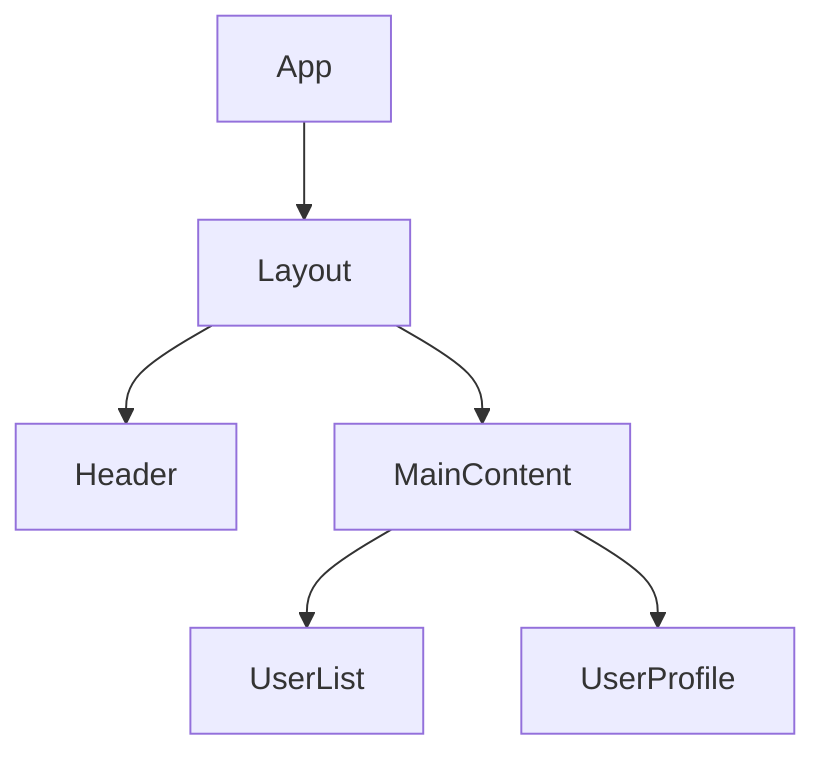

# 需求分析技能

## 技能概述

此技能专门用于自动查找项目需求文档并将其转化为可执行的Vue项目架构规划，包含：
- 自动查找项目主目录下的需求文档(.txt或.md格式)
- 自动生成组件层级结构图（Mermaid格式）
- 详细组件信息分析（命名、职责、分类）
- 标准Vue3项目文件结构生成
- 在requirement-analysis-result文件夹中输出分析结果

## 自动处理流程

### 1. 自动查找需求文档
技能将自动在项目主目录中查找：
- 需求文档.txt
- 需求文档.md
- requirement.txt
- requirement.md

### 2. 验证和准备输出目录
- 检查是否存在requirement-analysis-result文件夹
- 如果存在且包含子文件，先删除所有子文件
- 确保输出目录干净整洁

### 3. 自动分析处理
技能将自动：
- 读取找到的需求文档内容
- 识别核心功能模块
- 分析用户交互流程
- 确定组件职责边界
- 规划数据流向

### 4. 生成分析结果
在requirement-analysis-result文件夹中生成：
- 组件层级关系图（Mermaid格式）
- 各组件详细信息表
- 标准文件目录结构
- 组件分类说明
- 详细设计文档

## 组件分类标准

### 视图显示组件 (Views)
- 负责页面级别的视图展示
- 通常对应路由组件
- 包含页面整体布局和主要功能区域

### 页面布局组件 (Layouts)
- 提供页面结构框架
- 包含头部、侧边栏、主内容区等
- 可被多个页面复用

### 内容组件 (Components)
- 实现具体业务功能
- 可复用的业务逻辑单元
- 专注于特定功能领域

### 工具组件 (Utilities)
- 基础UI组件库
- 表单控件、按钮、弹窗等
- 高度可复用的基础组件

### API服务组件 (Services)
- 封装HTTP请求逻辑
- 统一数据访问层
- 错误处理和数据转换

## 输出格式规范

### 层级结构图 (Mermaid)


### 组件信息表
| 组件名 | 类型 | 职责描述 | 文件路径 | 依赖关系 |
|--------|------|----------|----------|----------|
| UserList | 内容组件 | 显示用户列表信息 | src/components/user/UserList.vue | UserService |

### 文件结构
```
src/
├── views/           # 页面视图组件
├── layouts/         # 页面布局组件  
├── components/      # 业务内容组件
│   ├── common/      # 通用工具组件
│   └── business/    # 业务专用组件
├── services/        # API服务封装
├── stores/          # 状态管理
└── utils/           # 工具函数
```

### 详细设计文档
- **架构设计**：组件创建决策、函数设计策略
- **路由规划**：Router-Link/Router-View放置位置
- **数据传输**：组件间通信机制详解
- **复用策略**：组件和函数的复用方案

## 最佳实践建议

1. **组件命名**：使用PascalCase，体现功能含义
2. **职责单一**：每个组件专注一个核心功能
3. **适度抽象**：避免过度工程化
4. **可测试性**：考虑组件的可测试性设计
5. **文档完善**：为复杂组件添加使用说明

## 使用示例

技能将自动执行以下操作：

**自动查找**：在项目主目录中查找需求文档文件
- 查找文件名：需求文档.txt、需求文档.md、requirement.txt、requirement.md

**自动处理**：如果找到需求文档，将自动生成分析结果

**输出位置**：在项目主目录下创建requirement-analysis-result文件夹，包含：
1. 组件层级结构图（Mermaid格式）
2. 详细的组件信息表格
3. 完整的项目文件结构
4. 各组件的基础模板代码

**错误处理**：如果未找到需求文档，将返回提示："无需求文档！"
